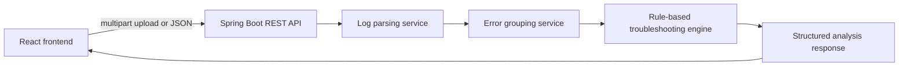

# LogLens: Smart Log Analyzer & Debugging Assistant

LogLens turns a raw application log into a structured debugging report. It detects errors, collapses
repeated exceptions into groups, extracts stack traces and root-cause candidates, and suggests what to check,
using deterministic, explainable rules that run entirely on your own machine.

> **Abstract.** LogLens is a local developer tool built with React and Spring Boot. A user uploads a
> `.log` or `.txt` file; the backend parses log levels and multiline Java stack traces, groups similar errors
> using normalised messages and stack-frame information, and applies a local rule set to propose possible
> causes. The React dashboard shows counts, charts, searchable error groups and an exportable JSON report. No
> database, login, cloud service, API key or external AI is used.

## Problem statement

When an application fails, developers and QA engineers face thousands of log lines. Finding the main error,
spotting that the same exception repeats hundreds of times, and understanding where it comes from takes time.
LogLens reduces that effort by presenting a short, searchable list of distinct problems instead of raw lines.

## Features

- Upload `.log` / `.txt` by drag and drop or file picker, with client and server validation (type, size, empty, binary)
- Log-level detection: FATAL, ERROR, WARN/WARNING, INFO, DEBUG, TRACE, plus UNKNOWN for anything unrecognised
- Common formats: `2026-10-22 10:30:12 ERROR ...`, ISO-8601 with `T`/`Z`, `[ERROR] ...`, `ERROR ...`, Logback/Log4j and Spring Boot layouts
- Dynamic exception extraction (custom and unknown exception types work), multiline stack traces, `Caused by`, `Suppressed`
- Duplicate error grouping with a stable key that handles changing timestamps, ids and addresses without merging genuinely different errors
- Root-cause *candidate* (deepest `Caused by`, clearly labelled a heuristic)
- Local rule-based suggestions for 14 error categories, always labelled "possible explanation, not a confirmed diagnosis"
- Dashboard: summary cards, level distribution, top exceptions, most frequent error groups (all from real analysed data)
- Search, level / exception-type / occurrence filters, sorting and expandable details, without re-uploading
- Optional masking of obvious secrets, and JSON report export
- Built-in sample log, clearly labelled as sample data
- Dark theme (default) and light theme, responsive layout

## Architecture



See [docs/architecture.md](docs/architecture.md) for details.

## Tech stack

| Layer | Technology |
| --- | --- |
| Frontend | React 18, JavaScript, Vite 5, HTML5, CSS3, Recharts |
| Backend | Java 21, Spring Boot 3.3, Maven, Spring Web, Bean Validation, Jackson, Java NIO/IO for safe handling |
| Tests | JUnit 5, Mockito (available via Spring Boot Test), Spring Boot Test, Vitest, React Testing Library |
| Storage | None. Everything is processed in memory and discarded. |

## Folder structure

```
loglens/
├── backend/
│   ├── pom.xml
│   └── src/
│       ├── main/java/com/loglens/{config,controller,dto,exception,model,parser,service}
│       ├── main/resources/application.properties
│       └── test/java/com/loglens/{controller,parser,service}
├── frontend/
│   ├── package.json, vite.config.js, index.html, .env.example
│   └── src/{components,pages,services,hooks,utils,test}, App.jsx, main.jsx, index.css
├── samples/sample-application.log
├── docs/{architecture.md, api-examples.md, verification-status.md}
├── .gitignore
├── LICENSE
└── README.md
```

## Prerequisites (Windows)

| Tool | Version | Check |
| --- | --- | --- |
| JDK | 21 | `java -version` |
| Maven | 3.9+ | `mvn -version` |
| Node.js | 18 or newer (20 LTS recommended) | `node -v` |
| npm | comes with Node | `npm -v` |

## Run it (Windows PowerShell)

Open **two** PowerShell windows.

**1. Backend** (http://localhost:8080)

```powershell
cd loglens\backend
mvn clean test
mvn spring-boot:run
```

Check it: `Invoke-RestMethod http://localhost:8080/api/health`

**2. Frontend** (http://localhost:5173)

```powershell
cd loglens\frontend
npm install
npm run dev
```

Open http://localhost:5173. In development, Vite proxies `/api` to the backend, so no CORS setup is needed.

## Try the sample log

Click **Try the sample log** in the UI, or upload `samples\sample-application.log`. The sample is synthetic
(it contains repeated `NullPointerException`s, connection-refused errors, SQL exceptions with a nested cause,
warnings, info lines, a fake password to demonstrate masking, and some unrecognised lines). Its results are
demonstration data, not benchmarks.

## Example analysis

For the bundled sample, LogLens reports 72 lines, 4 unrecognised lines, 24 log entries and 9 error groups. The
most frequent group is a `NullPointerException` at `UserService.java:42` seen 3 times; a different
`NullPointerException` at `OrderService.java:88` stays a separate group. These numbers come from the sample
file and are asserted in `LogAnalysisServiceTest`.

## API

| Method | Path | Purpose |
| --- | --- | --- |
| GET | `/api/health` | Backend health |
| POST | `/api/logs/analyze` | Multipart upload (`file`, optional `redact`) |
| POST | `/api/logs/analyze-text` | JSON `{ "text": "...", "redact": true }` |
| GET | `/api/logs/sample` | Bundled sample log and its analysis |
| GET | `/api/logs/error-rules` | The local troubleshooting rules |

Examples, the response shape and the error format are in [docs/api-examples.md](docs/api-examples.md).

## Configuration

`backend/src/main/resources/application.properties`:

| Property | Default | Meaning |
| --- | --- | --- |
| `loglens.max-upload-bytes` | `10485760` (10 MB) | Upload and text size limit (also drives the Spring multipart limit) |
| `loglens.allowed-extensions` | `log,txt` | Accepted file extensions |
| `loglens.allowed-origins` | `http://localhost:5173,http://127.0.0.1:5173` | Browser origins allowed to call the API directly |

If you change the size limit, set `VITE_MAX_UPLOAD_MB` in `frontend/.env` (see `.env.example`) to match.

## Testing

```powershell
cd loglens\backend;  mvn test
cd loglens\frontend; npm test
```

Backend tests cover level detection, timestamp parsing, multiline stack traces, grouping (including
"different errors are not merged" and "dynamic values are normalised"), root-cause extraction, rules, redaction,
file validation, API responses and error formats. Frontend tests cover upload and validation, rendering of
results, search and filtering, sorting, expandable details and JSON export. See
[docs/verification-status.md](docs/verification-status.md) for what has and has not been executed so far.

## Security and privacy

- Logs are processed only by your own backend. There are no outbound calls and no external AI.
- Nothing is stored. Uploads are held in memory; no temporary files are written; the client file name is never used as a path.
- Size, extension, empty and binary-content checks run on the server (the UI checks too).
- Error responses contain no stack traces, file paths or log content; the application log records only counts.
- **Warning:** logs may contain passwords, tokens, e-mail addresses and IP addresses. Masking of obvious
  `password=`, `token=`, `Authorization`, Bearer/JWT, AWS-style keys and URL credentials is on by default but
  is pattern-based and **cannot guarantee** that every secret is hidden. Review before sharing a report.
- The JSON export contains the summary, groups, suggestions and up to three representative lines per group, not the full log or raw stack-trace lines.

## Known limitations

- Only ISO-style timestamps (`yyyy-MM-dd HH:mm:ss[.SSS]`, with `T`, `Z` or an offset) are recognised; other formats still parse levels but show no time.
- Log levels must be upper-case words (`ERROR`, not `error`).
- Only Java-style stack traces are understood. Other languages' traces appear as unrecognised lines.
- A multiline message that is not a stack trace (for example a SQL dump after an `ERROR` line) counts as unrecognised lines.
- Parsed timestamps are wall-clock values; time-zone offsets are not retained.
- Grouping keeps short numbers and hosts distinct on purpose, so some near-duplicates (for example `Index 5` and `Index 7`) stay separate.
- Rotated names such as `app.log.2026-10-22` are rejected unless you add the extension in configuration.
- Files are limited to 10 MB by default and are analysed in memory.
- Suggestions are heuristics from a small rule set, not diagnoses.

## Future enhancements

- More timestamp formats and non-Java stack traces (Python, .NET, Node)
- Streaming parse for very large files
- Compare two logs (before/after a fix)
- Custom user-defined rules and normalisation patterns
- Optional local clustering/ML model behind the existing service boundaries
- Docker packaging and CI

## Screenshots

> **Placeholders only.** No screenshots have been captured yet. Replace these after running the app.

| Screen | File |
| --- | --- |
| Upload and empty state | `docs/screenshots/PLACEHOLDER-upload.png` |
| Dashboard with charts | `docs/screenshots/PLACEHOLDER-dashboard.png` |
| Expanded error group | `docs/screenshots/PLACEHOLDER-details.png` |

## Interview summary

"LogLens is a local log-analysis tool I built with Java 21 / Spring Boot and React. It parses logs including
multiline Java stack traces, groups duplicate errors using a normalised key made of exception type, message,
root cause and top stack frame, and suggests possible causes through an explainable rule engine instead of a
black-box model. The interesting engineering problems were deciding what to normalise (timestamps and ids yes,
ports and hosts no), keeping the parser robust against malformed input, protecting privacy (in-memory only,
secret masking, no external calls), and keeping the frontend and backend contract consistent. I tested the
parsing, grouping and validation logic with JUnit and the UI with Vitest and React Testing Library."

## Git setup

```powershell
cd loglens
git init
git add .
git commit -m "chore: initial LogLens project"
git branch -M main
git remote add origin https://github.com/<your-user>/loglens.git
git push -u origin main
```

Suggested commit messages for a staged history:

1. `chore: add Spring Boot backend skeleton with health endpoint and error handling`
2. `feat(parser): detect log levels and timestamps, attach multiline stack traces`
3. `feat(grouping): group duplicate errors with normalised keys and root-cause heuristic`
4. `feat(rules): add local rule-based troubleshooting engine and redaction`
5. `feat(api): add analyze, analyze-text, sample and error-rules endpoints with validation`
6. `test(backend): add parser, grouping, rules, validation and controller tests`
7. `feat(ui): add upload panel, summary cards and charts`
8. `feat(ui): add filters, expandable error groups and JSON export`
9. `test(ui): add Vitest and React Testing Library tests`
10. `docs: add README, architecture notes and API examples`

## License

MIT. See [LICENSE](LICENSE).
