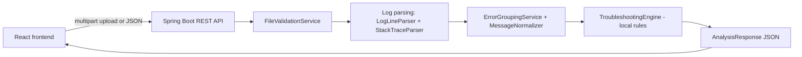

# LogLens architecture

Nothing is stored. A request is processed in memory and discarded. No external service, API key or
AI model is involved.

## Backend packages (`com.loglens`)

| Package | Responsibility |
| --- | --- |
| `controller` | HTTP only: `HealthController`, `LogController`. No parsing logic. |
| `dto` | Request and response records (`AnalysisResponse`, `AnalysisSummary`, `ErrorResponse`, ...). |
| `service` | `FileValidationService`, `LogAnalysisService`, `ErrorGroupingService`, `TroubleshootingEngine`, `RedactionService`, `SampleLogService`. |
| `parser` | `LogLineParser` (levels, timestamps, multiline entries), `StackTraceParser`, `MessageNormalizer`. |
| `model` | Immutable records shared by parser and services (`LogEntry`, `ErrorGroup`, `StackTraceInfo`, ...). |
| `exception` | `InvalidLogFileException` (400), `FileTooLargeException` (413), `GlobalExceptionHandler`. |
| `config` | `LogLensProperties` (limits, extensions, origins) and `CorsConfig`. |

## Request flow

1. **Validate.** Name, extension (`.log`, `.txt`), size and "does it look binary" are checked. The
   client's file name is only sanitised for display; the file is never written to disk.
2. **Parse.** Each line is matched against `[timestamp] [thread] LEVEL message`. A line with a level
   starts a new entry; stack-trace lines (`at ...`, `Caused by:`, `Suppressed:`, `... N more`, and exception
   header lines) attach to it. Lines that fit neither are counted as UNKNOWN, never guessed.
3. **Group.** ERROR and FATAL entries, plus WARN entries that carry an exception, are grouped.
4. **Explain.** Each group gets suggestions from the rule engine.
5. **Summarise.** Level counts, percentages, top exceptions, warnings and dashboard numbers are computed.

## How errors are grouped

The group key is built from:

- the main exception type and its normalised message,
- the root-cause candidate (type and normalised message) when there is a `Caused by` chain,
- the top relevant stack frame (class, method, line number),
- for errors with neither an exception message nor a frame: the normalised log message.

`MessageNormalizer` replaces values that change between otherwise identical errors: timestamps, UUIDs,
hex addresses, object identity hashes (`Foo@1a2b3c`), `requestId=...`-style ids, pool/thread numbers and
numbers with 6 or more digits. It deliberately does **not** normalise hosts, IP addresses, ports or short
numbers, because those usually distinguish different problems (`localhost:5432` vs `localhost:6379`).

Group ids are the first 8 bytes of a SHA-256 hash of the key, so they are stable across runs.

## Root-cause heuristic

The deepest `Caused by` entry is reported as the *root-cause candidate*. The response says explicitly that
this is a heuristic. Its application frames (code outside `java.`, `org.springframework.` and similar
prefixes) are listed first.

## Troubleshooting engine

A fixed, ordered list of rules (see `GET /api/logs/error-rules`). Rules that match the root-cause
exception are listed before rules that only match a wrapper exception. At most three suggestions are
returned. If nothing matches, a generic "no specific rule matched" suggestion is returned that proposes
no cause. Every suggestion carries the disclaimer that it is a possible explanation, not a diagnosis.

## Privacy and redaction

- Processing is local to your own backend; there are no outbound calls.
- Only counts are written to the application log, never log content.
- `RedactionService` masks obvious `password=`, `token=`, `api_key=`, `Authorization`, Bearer/JWT,
  AWS-style keys and `user:pass@` URL credentials. It is pattern-based and best-effort.
- Redaction is applied to everything placed in the response (messages, representative lines, stack-trace
  text). Grouping uses the original text, so masking never merges different errors.

## Extending toward machine learning

The parsing, normalisation and grouping stages produce a structured `LogEntry` and `ErrorGroup` model. A
future local model (for example clustering or classification) could be added behind the same service
boundaries. LogLens does not currently contain any machine-learning component.
